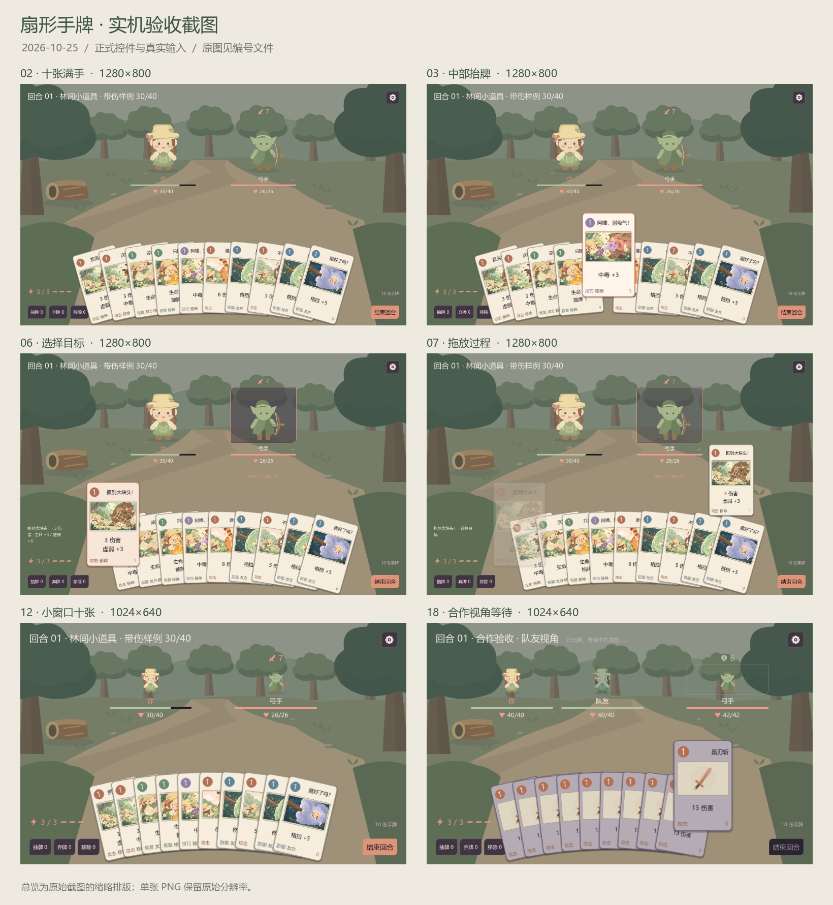

# 扇形手牌验收截图

2026-10-25。18 张原始实机截图，另附 1 张总览。

使用正式 BattleScreen / HandFan，通过真实鼠标和键盘输入切换状态；保留原始分辨率，不手动重排卡牌或修饰画面。十张满手通过独立试玩额外抽五张构造；空手牌与合作等待使用独立内存用例，合作图展示模拟等待界面。

| 截图 | 分辨率 | 验收观察 |
| --- | --- | --- |
| [01 · 五张常态](01_five_1280.png) | 1280×800 | 浅扇形、能量在左、牌堆与结束回合保持可见 |
| [02 · 十张满手](02_ten_1280.png) | 1280×800 | 十张同时在屏内，费用区域逐张露出，无横向滚动 |
| [03 · 中部抬牌](03_hover_middle_1280.png) | 1280×800 | 抬高、放大、转正，邻牌让位 |
| [04 · 最左抬牌](04_hover_left_1280.png) | 1280×800 | 左端卡面完整，牌堆按钮仍可见 |
| [05 · 最右抬牌](05_hover_right_1280.png) | 1280×800 | 右端卡面完整，结束回合仍可见 |
| [06 · 选择目标](06_target_preview_1280.png) | 1280×800 | 所选牌保持抬起，目标高亮与效果预览可见 |
| [07 · 拖放过程](07_dragging_1280.png) | 1280×800 | 完整卡面跟随鼠标，手中原牌淡化并保留槽位 |
| [08 · 出牌后补位](08_after_play_1280.png) | 1280×800 | 十张变九张，能量 3→2；敌方获得实际结算状态 |
| [09 · 无能量阅读](09_no_energy_1280.png) | 1280×800 | 费用不足置灰，仍可悬停查看完整牌面 |
| [10 · 移除区弹窗](10_pile_modal_1280.png) | 1280×800 | 已打出的道具牌可查看，弹窗覆盖并阻断手牌输入 |
| [11 · 小窗口五张](11_five_1024.png) | 1024×640 | 132×204 卡面，全部操作留在窗口内 |
| [12 · 小窗口十张](12_ten_1024.png) | 1024×640 | 密集扇形，左右操作区和十个费用区域可见 |
| [13 · 小窗口中部抬牌](13_hover_middle_1024.png) | 1024×640 | 展开后不遮挡角色生命与敌人意图 |
| [14 · 小窗口右端抬牌](14_hover_right_1024.png) | 1024×640 | 右端放大不出屏，结束回合可见 |
| [15 · 小窗口目标预览](15_target_preview_1024.png) | 1024×640 | 选牌、角色信息与目标预览同时可读 |
| [16 · 两张剩牌](16_two_cards_1024.png) | 1024×640 | 少牌自动居中收拢，无大角度倾斜 |
| [17 · 空手牌](17_empty_hand_1024.png) | 1024×640 | 提示手牌用尽，结束回合仍可操作 |
| [18 · 合作视角等待](18_coop_waiting_1024.png) | 1024×640 | p2 的第十张保持槽位；模拟等待期间禁用重复提交 |

运行：Godot 4.6.1，OpenGL compatibility；脚本 tools/capture_hand_fan_acceptance.gd。运行结果和逐图状态摘要见 capture_result.json。
